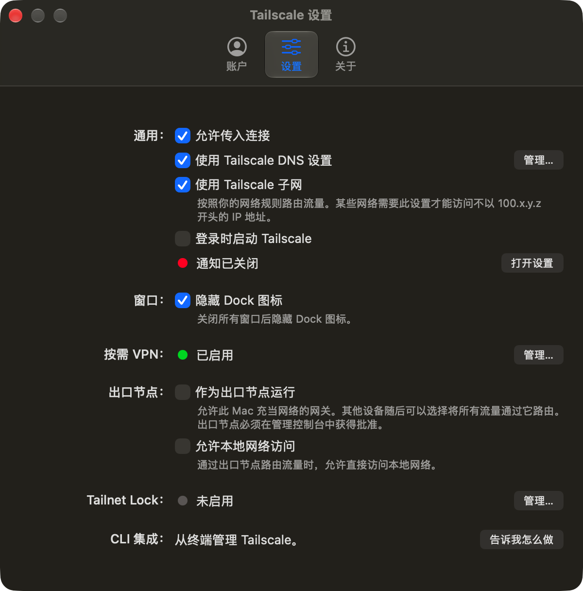

# Tailscale macOS 简体中文语言包（非官方）

[English](#english) · [安装](#安装) · [卸载](#卸载) · [常见问题](#常见问题)



非官方社区汉化包，为 Tailscale macOS 独立版提供简体中文界面。通过添加 `zh-Hans.lproj` 语言资源实现，不修改可执行文件，不接触账户或网络配置。

## 适配版本

- Tailscale **1.104.2** Standalone / macsys 版（`io.tailscale.ipn.macsys`）
- macOS 13.5 或更高
- 不适用于 Mac App Store 版；其他版本通常可用，新增文案会回退英文

## 覆盖范围

- 设置窗口、菜单栏菜单、账户、退出确认
- 通知、引导、错误提示、更新提示
- 共 1,093 条文案（含标准 Edit 菜单）
- 术语：tailnet → 网络 / Tailscale 网络，exit node → 出口节点，subnet routing → 子网路由，auth key → 身份验证密钥；Taildrop、Taildrive、MagicDNS、Tailnet Lock、DERP 保留英文

## 安装

下载 Release 压缩包，或克隆仓库：

```bash
git clone https://github.com/maowei-cmd/tailscale-macos-zh.git
cd tailscale-macos-zh
./install.sh
```

脚本会请求一次管理员授权，将 `zh-Hans.lproj` 写入 `/Applications/Tailscale.app/Contents/Resources/`。完成后退出并重新打开 Tailscale。

系统语言为简体中文时自动生效。如系统语言不是中文，可在“系统设置 → 通用 → 语言与地区 → 应用程序”中把 Tailscale 设为“简体中文”。

## Tailscale 更新后

自动更新会替换 App、清除语言包。重新执行 `./install.sh` 即可。

## 卸载

```bash
./uninstall.sh
```

删除语言目录即可恢复英文；不会影响 Tailscale 的登录、配置或隧道。

## 实现原理与签名

Tailscale 自带语义化字符串表和 `Base.lproj`，但未提供中文资源。本项目补充 `zh-Hans.lproj`，Foundation 在中文系统下会自动选择它。

由于向已签名 App 添加了资源，`codesign` 会报告 `a sealed resource is missing or invalid`，这是预期现象；可执行文件和网络扩展未被修改。删除语言目录后签名校验会恢复（已验证）。本项目不会重新签名 App。

## 已知限制

- Tailscale 更新会覆盖语言包
- 新版本新增或调整的文案会显示英文，等待本项目更新
- 极少数由系统或后端动态生成的内容可能不在字符串表中
- 非官方项目，不保证通过 Tailscale 官方支持渠道

## 免责声明

本项目与 Tailscale Inc. 无关联，未获其背书或赞助。Tailscale、Taildrop、Taildrive、MagicDNS、Tailnet Lock 等名称和商标归 Tailscale Inc. 所有。本仓库不包含 Tailscale App 本体、二进制或原始英文字符串资源，仅包含中文译文和安装脚本。若权利人提出要求，维护者将配合调整或下架相关内容。

## 贡献

欢迎提交 Issue / PR。修改 `.strings` 时请：

- 保留 `%@`、`%d`、`%lld` 等占位符及顺序
- 保留 Markdown 链接地址和 `\n` 换行
- 运行 `./scripts/validate.sh` 校验文件
- 说明适配的 Tailscale 版本

## License

[MIT](LICENSE)。Tailscale App 及其原始资源不适用本许可证，相关权利归 Tailscale Inc.。

## 常见问题 / FAQ

**安装后还是英文？**  
先完全退出 Tailscale 再打开。若系统语言不是简体中文，请在“系统设置 → 通用 → 语言与地区 → 应用程序”中为 Tailscale 单独选择“简体中文”。

**为什么 `codesign` 校验失败？**  
语言包是额外资源，未重新签名。删除 `zh-Hans.lproj` 后校验会恢复。

**会影响 Tailscale 网络或登录吗？**  
不会。安装脚本只复制语言资源，不修改配置、凭据或网络扩展。

**Tailscale 更新后怎么办？**  
重新运行 `./install.sh`。

---

## English

Unofficial Simplified Chinese localization for the **Tailscale macOS standalone app**. It adds a `zh-Hans.lproj` resource directory; the binary, account data, and network configuration are untouched.


### Compatibility

- Tailscale **1.104.2** Standalone (macsys, `io.tailscale.ipn.macsys`)
- macOS 13.5+
- Not for the Mac App Store variant. Other versions may work; new strings fall back to English.

### Install

```bash
git clone https://github.com/maowei-cmd/tailscale-macos-zh.git
cd tailscale-macos-zh
./install.sh
```

The script asks for administrator authorization and installs the resource files. Quit and reopen Tailscale afterwards. Chinese is selected automatically when the system language is Simplified Chinese.

### After a Tailscale update

Re-run `./install.sh`.

### Uninstall

```bash
./uninstall.sh
```

### Notes

- Adding resources invalidates the app's code signature (`codesign` reports a sealed resource error). This is expected; deleting `zh-Hans.lproj` restores it. The project does not re-sign the app.
- Not affiliated with Tailscale Inc. Tailscale and related marks are trademarks of Tailscale Inc. This repository contains no app binaries or original English string resources.
- License: MIT.
